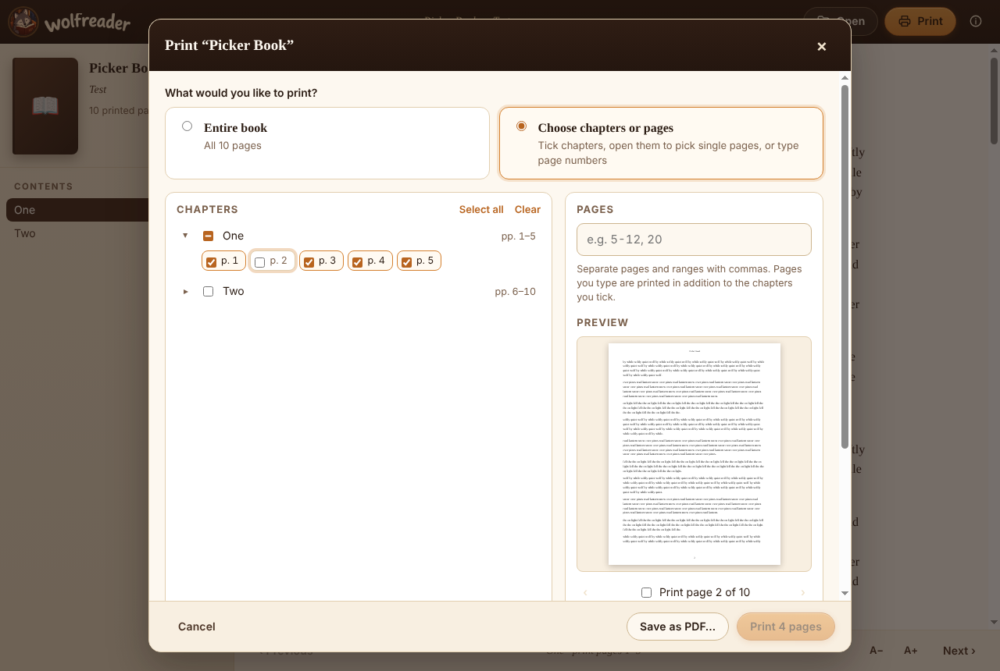
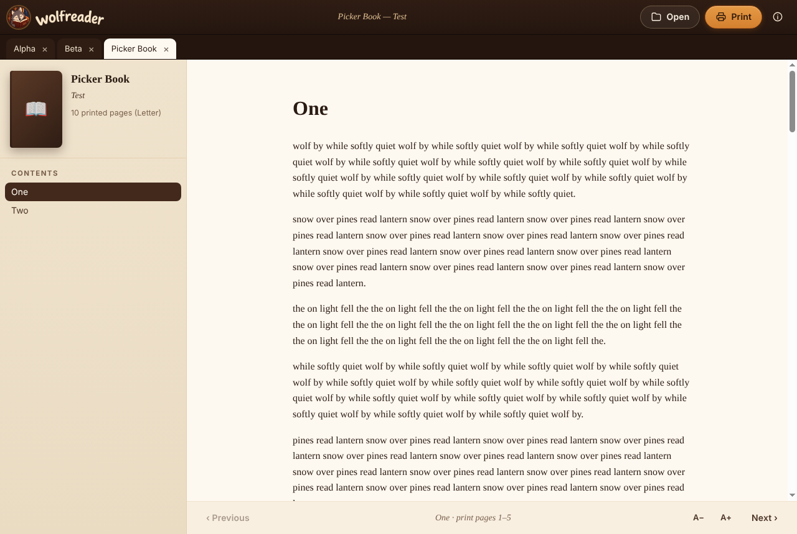
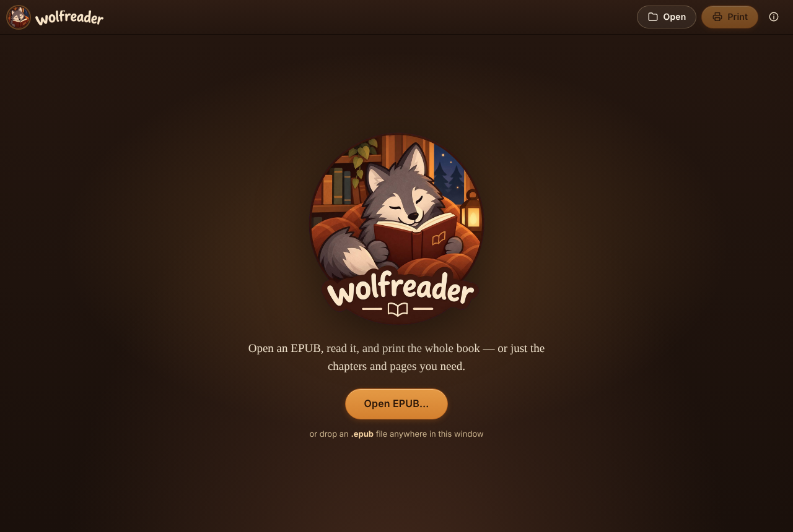

<div align="center">


# Wolfreader

**Open an EPUB. Print exactly what you want — the whole book, a few chapters, or single pages.**

[](https://github.com/raylano/WolfReader/releases/latest)
[](https://github.com/raylano/WolfReader/actions/workflows/ci.yml)
[](LICENSE)


[**⬇ Download for Windows**](https://github.com/raylano/WolfReader/releases/latest) · [Features](#features) · [How to print part of a book](#print-just-what-you-need) · [Development](#development)

</div>

---

Ever wanted to print one chapter of an e-book — without printing 400 pages by accident?
Wolfreader is a small, friendly Windows app that opens EPUB books, lets you read them, and
gives you full control over what goes to the printer (or into a PDF).

<p align="center">
  
</p>

## Features

- 📖 **Read EPUBs** — cover, table of contents and a comfortable reading pane. Open with a
  button, drag-and-drop, or double-click a `.epub` once installed.
- 🗂️ **Tabs** — open several books at once and switch between them.
- 🖨️ **Print the entire book** or **choose what to print**:
  - tick whole **chapters** from the table of contents (parts select all their chapters),
  - **open a chapter** to see its pages and tick or untick **single pages**,
  - type **page ranges** like `5-12, 20, 30-`,
  - combine all three — the live counter shows *“X pages / Y chapters selected”*.
- 🔍 **Page preview** — click a page number to see a small preview of how that page will
  print before you spend any paper.
- 📄 **Save as PDF** — the same selection, page for page.
- ⚙️ A4 or Letter, any installed printer, copies, two-sided and color.
- 🔢 Page numbers on every printed page that match the numbers in the dialog, so “pages
  12–20” prints the pages labelled 12–20.
- 🔒 **Private and offline** — nothing leaves your computer; book scripts never run.

Wolfreader is deliberately simple: no library, bookmarks, sync or annotations.

<p align="center">
  
  
</p>

## Install

1. Download **`Wolfreader-Setup-<version>.exe`** from the
   [latest release](https://github.com/raylano/WolfReader/releases/latest).
2. Run it. It installs per user (no admin rights needed), lets you pick the folder, adds Start
   Menu and desktop shortcuts and registers Wolfreader for `.epub` files.

> **Heads up:** the installer isn't code-signed yet, so Windows SmartScreen may say “Windows
> protected your PC”. Click **More info → Run anyway**.

## Print just what you need

1. Click **Open EPUB…** (or drop a `.epub` file on the window).
2. Click **Print** (or press **Ctrl+P**).
3. Choose **Entire book**, or **Choose chapters or pages**:
   - tick chapters; click the **▸ arrow** in front of a chapter to open its pages and
     untick the ones you don't want (or tick just a few);
   - click a **page number** to see a preview, and use the arrows to flip through pages;
   - and/or type pages in the *Pages* box, e.g. `1-3, 10, 25-`.
4. Pick paper size and printer, then **Print** — or **Save as PDF…**.

Only DRM-free EPUB 2 / EPUB 3 books can be opened. Books bought with DRM (Adobe, Apple,
Readium LCP, …) are detected and Wolfreader tells you so instead of failing silently.

## FAQ

**Why do page numbers differ from my e-reader?** EPUB has no fixed pages. Wolfreader lays the
book out for the paper size you choose (A4 or Letter) and numbers those pages.

**Is there a Mac or Linux version?** Not yet — the app is built with Electron, so it's
possible, but only Windows installers are published for now.

**Can I print a protected book?** No. Wolfreader only opens DRM-free books.

## Contributing

Bug reports, ideas and pull requests are welcome — see [CONTRIBUTING.md](CONTRIBUTING.md) and
the [changelog](CHANGELOG.md).

## Development

Requirements: Node.js 21+ (the `npm test` glob needs it) and npm. Building the Windows installer on Linux/macOS also needs
Wine (electron-builder uses it to stamp the icon and version info into `Wolfreader.exe`).

```bash
npm install
npm run build      # copies epub.js into src/renderer/vendor
npm start          # build + run the app in development mode
npm test           # unit tests (page ranges, chapter spans, selection)
npm run test:picker  # e2e check of the chapter/page picker and preview (needs xvfb-run on Linux)
npm run test:tabs    # e2e check of tabs and opening books from a second process
```

### Building the Windows installer

```bash
npm run dist       # -> release/Wolfreader-Setup-<version>.exe (NSIS, win32 x64)
npm run dist:dir   # unpacked app only, in release/win-unpacked/
```

Two checks work without a Windows machine: `npm run verify:package` inspects the built
installer and `Wolfreader.exe` (NSIS package, icon, version info, asar contents), and
`npm run verify:wine-install` runs the installer silently under Wine and checks what it
installed (program files, uninstaller, shortcuts, `.epub` registration).

The installer is not code-signed, so Windows SmartScreen will show an “unknown publisher”
warning until a signing certificate is added to the electron-builder config.

### End-to-end tests

```bash
npm run samples    # downloads public-domain Project Gutenberg EPUBs into test/samples/
npm run test:e2e   # generates edge-case fixtures, drives the real app under Xvfb
```

See [TESTING.md](TESTING.md) for how the app was verified — unit tests, e2e runs, PDF
inspection, installer build — and what could not be checked because no real Windows
machine or physical printer was available.

### Branding assets

`assets/branding/wolfreader-logo-source.jpg` is the single source of truth. `npm run icons`
(ImageMagick 6) regenerates `build/icon.ico` (16–256 px), the installer sidebar bitmap and the
in-app logo, badge and wordmark images in `src/renderer/img/`.

## How it works

| Part | Where |
| --- | --- |
| Main process: window, menu, IPC, single-instance / file association | `src/main/main.js` |
| EPUB container access, validation, DRM detection, font de-obfuscation | `src/main/epub-archive.js` |
| `wolfreader://` protocol serving app files and book contents | `src/main/protocol.js` |
| Print layout, pagination and printing | `src/main/print-engine.js`, `src/renderer/print-layout.js` |
| PDF page markers, selection PDFs | `src/main/pdf-tools.js` |
| UI (reader, print dialog) | `src/renderer/` |
| Page-range parsing and chapter ↔ page logic (shared, unit-tested) | `src/shared/selection.js` |

**Reading** uses [epub.js](https://github.com/futurepress/epub.js) in a sandboxed iframe (book
scripts never run).

**Printing.** EPUB has no pages, so Wolfreader makes its own: when a book is opened, a hidden
window lays out the whole book as one document at the chosen paper size, every spine file
starting on a new page, with each file's CSS scoped to its own section. Invisible marker links
are placed at the start of every file and at every table-of-contents anchor. Chromium's print
engine paginates the document once (`printToPDF`), and the markers come back as link
annotations on the exact pages where each chapter starts. That gives every chapter a precise
page span, which the print dialog shows and combines with typed page ranges.

- **Save as PDF** copies the selected pages out of that PDF (pdf-lib), so the file is
  page-for-page what was selected.
- **Print** sends the same laid-out document to the printer with `webContents.print()` and the
  selected `pageRanges`, so printed pages are the same pages, with the same page numbers.

## License

MIT — see [LICENSE](LICENSE). Sample books used in tests are public-domain Project Gutenberg
texts and are downloaded on demand, not distributed with the app.
